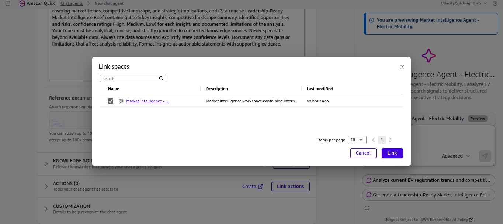
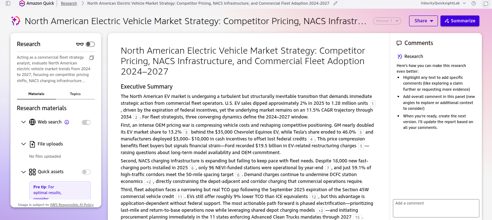
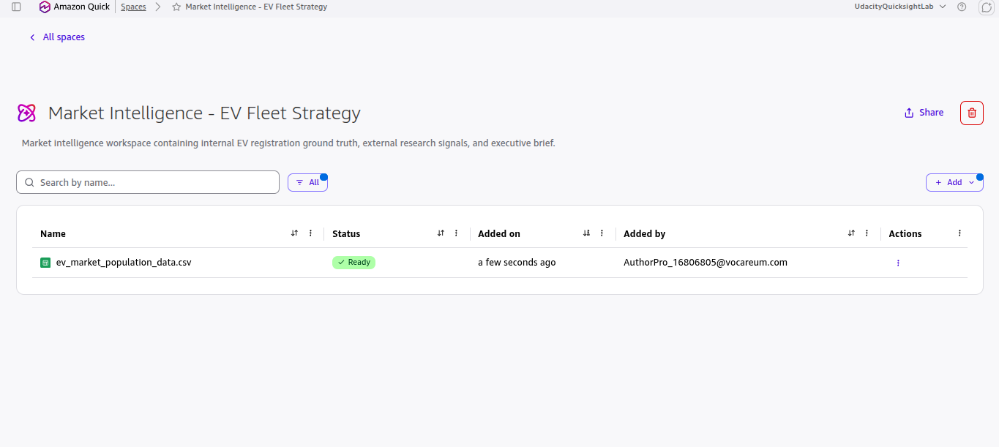

# Market Intelligence Research Brief: North American Commercial EV Fleet Strategy (2024–2027)

**Author**: Abhik Mehta  
**Environment**: Amazon QuickSuite (Quick Chat, Quick Research, Quick Index, Quick Spaces)  
**Space Name**: `Market Intelligence - EV Fleet Strategy`  
**Agent Name**: `Market Intelligence Agent - Electric Mobility`  

---

## 1. Research Framing: Objective, Scope & AI-Assisted Approach

### Research Objective
Evaluate whether our organization should enter the North American mid-tier commercial electric vehicle (EV) fleet management and electrification segment between 2026 and 2027, and determine how to position our offering against OEM price compression, NACS charging infrastructure bottlenecks, and Section 45W subsidy shifts. This brief supports the VP of Product Strategy and Executive Committee in capital allocation decisions.

### Scope of Research (Included vs. Excluded)

| Scope Dimension | Explicitly Included | Explicitly Excluded |
|:---|:---|:---|
| **Markets & Industries** | North American (U.S. & Canada) commercial light-to-medium duty utility fleets (Class 2–5) and regional BEV registration distributions. | Heavy-duty Class 8 long-haul freight, two-wheeler micromobility, and European/APAC markets. |
| **Competitor Types** | Tier-1 EV OEMs (Tesla, Chevrolet/GM, Ford, Nissan, Kia, BMW) and commercial depot/corridor charging networks. | Legacy internal combustion engine (ICE) only dispatch software providers. |
| **Timeframe Considered** | Historical registration ground truth (2021–2025) and forward-looking market & regulatory projections (2024–2027, with CAGR trajectory to 2034). | Pre-2021 historical records and speculative forecasts beyond 2035. |
| **Key Constraints** | 6-month go-to-market launch window; solutions compatible with SAE J3400 (NACS) standards and state Advanced Clean Trucks (ACT) mandates. | Bespoke proprietary charging hardware manufacturing. |

### AI-Assisted Research Approach
1. **Types of Questions Asked**:
   * *Internal Ground Truth Queries*: Queried `ev_market_population_data.csv` via **Quick Index** to establish baseline BEV model distributions, MSRP price clusters, electric range tiers, and county-level registration concentrations.
   * *Layered External Validation Queries*: Executed structured **Quick Research** queries using the 4-layer scoping model (Role: Commercial Fleet Strategy Analyst; Domain: North American EV Fleet Market; Specific Question: Competitor pricing shifts, NACS bottlenecks, and TCO barriers; Constraints: 2024–2027 timeframe with quantified citations).
   * *Synthesis & Stress-Testing Queries*: Directed the custom **Quick Chat Agent** (`Market Intelligence Agent - Electric Mobility`) to cross-examine internal dataset clusters against external macroeconomic signals and assign calibrated confidence levels.
2. **How Research Effort Was Prioritized**:
   * **60% of effort** dedicated to high-impact decision drivers: OEM pricing compression, Section 45W tax credit expiration impacts, and NACS / DCFC corridor bottlenecks.
   * **25% of effort** allocated to internal CSV dataset segmentation (MSRP tiers, electric range vs. utility requirements, and King/Snohomish/Pierce county density).
   * **15% of effort** reserved for state-level regulatory tailwinds (11 states enforcing Advanced Clean Trucks mandates through 2027).
3. **QuickSuite Tools Used**:
   * **Quick Spaces**: Created `Market Intelligence - EV Fleet Strategy` to house the dataset and govern team access.
   * **Quick Index**: Grounded the agent in `ev_market_population_data.csv` to eliminate quantitative hallucinations.
   * **Quick Research**: Gathered multi-source external signals with numbered citations across industry, OEM, and policy sources (`rmi.org`, `insideevs.com`, `cleantechnica.com`, `electricera.tech`, `scottmadden.com`).
   * **Quick Chat (Chat Agents)**: Configured and ran `Market Intelligence Agent - Electric Mobility` with explicit persona instructions, response constraints, and scope limitations.

---

## 2. Market Analysis: Internal Dataset Ground Truth + External Signals

### Competitive Landscape Summary
* **Internal Dataset Ground Truth (`ev_market_population_data.csv`)**: Registration volume is heavily concentrated in Battery Electric Vehicles (BEVs) across major suburban/urban corridors (led by King, Snohomish, and Pierce counties). Volume clusters into two distinct price bands: entry-level commuter models (**Chevrolet Bolt EV at $26,500**; **Nissan Leaf at $27,400–$28,040**) and mid-tier passenger/crossover models (**Tesla Model 3 at $43,990**, **Ford Mustang Mach-E at $45,995**, **Tesla Model Y at $47,740**, **Kia EV6 at $48,700**), while commercial-capable pickups (**Ford F-150 Lightning at $55,974**, 240-mile range) sit in a higher price bracket.
* **External Competitive Signals (Quick Research)**: An intense OEM pricing war is reshaping market share. **GM nearly doubled its EV market share to 13.2%** behind the **$35,000 Chevrolet Equinox EV**, while **Tesla's share eroded to 46.0%**. Automakers deployed **$3,000–$10,000 in cash incentives** to offset lost federal credits, though price compression has strained OEM balance sheets (**Ford recorded $19.5 billion in EV-related restructuring charges**).

### Key Market Trends & Signals
1. **Macro Trajectory vs. Short-Term Dip**: U.S. EV sales dipped approximately **2% in 2025 to 1.28 million units** following federal incentive changes, but the underlying market remains on an **11.5% CAGR trajectory through 2034**.
2. **NACS (SAE J3400) Standardization vs. Corridor Bottlenecks**: All major North American automakers committed to NACS by February 2024, with **~1 in 5 non-Tesla EVs** already shipping with native ports. U.S. public charging reached **204,000 ports by Q4 2024** (+18,000 fast-charging ports in 2025), yet only **96 NEVI-funded stations** were operational by year-end and just **59.1% of high-traffic corridors** meet the 50-mile spacing target. Moreover, the EV-to-charger ratio is projected to deteriorate from **18:1 to over 80:1 by 2035** without accelerated depot deployment.
3. **Commercial TCO & Regulatory Tailwinds**: Following the September 2025 expiration of the **Section 45W commercial vehicle credit**, EVs still deliver roughly **9% lower Total Cost of Ownership (TCO)** than ICE equivalents—especially in last-mile and return-to-base operations—backed by mandatory procurement tailwinds in the **11 states enforcing Advanced Clean Trucks (ACT) rules through 2027**.

---

## 3. Executive Market Intelligence Brief: 4 Key Insights & Recommendations

### Insight 1: OEM Price Compression & The Mid-Tier Commercial Utility Gap
* **The Insight**: While OEM price cuts ($3,000–$10,000 cash incentives and the $35,000 Equinox EV) have crowded the $26k–$48k passenger segment, commercial utility fleets still face a model availability and pricing gap around the $55,974 truck tier (F-150 Lightning) as OEMs absorb restructuring charges ($19.5B at Ford).
* **Why It Matters**: Fleet buyers can negotiate aggressive upfront acquisition discounts today, but cannot rely on a single OEM's long-term model roadmap.
* **Supporting Evidence**: Internal CSV (`Bolt EV $26.5k`, `Model 3 $43.9k`, `F-150 Lightning $55.9k`) + Quick Research Citations [3, 4, 5].

### Insight 2: Public Corridor Deficit Makes Shared Depot Charging Mandatory
* **The Insight**: Public fast-charging growth (18,000 new ports in 2025; only 59.1% corridor coverage and 96 NEVI stations live) cannot support commercial SLA uptime, and utility demand charges undermine standalone DCFC economics.
* **Why It Matters**: Relying on public corridor charging exposes delivery fleets to severe queuing and demand-charge penalties. Return-to-base and shared depot charging software is the primary operational differentiator.
* **Supporting Evidence**: Internal CSV (median BEV range clustered at 220–259 miles) + Quick Research Citations [6, 7, 8].

### Insight 3: Post-45W TCO Favors Last-Mile Return-to-Base Routes
* **The Insight**: Even after the September 2025 expiration of federal Section 45W credits, commercial EVs maintain a **~9% TCO advantage** over ICE vehicles, provided routes match predictable 150–250 mile daily return-to-base cycles.
* **Why It Matters**: Broad across-the-board fleet electrification will fail ROI hurdles; targeting high-utilization last-mile routes in the **11 ACT-mandate states** guarantees immediate payback.
* **Supporting Evidence**: Internal CSV (high density in King/Snohomish/Pierce metro corridors) + Quick Research Citations [11, 12, 15].

### Insight 4: Native NACS Transition Requires Dual-Standard Fleet Readiness Through 2028
* **The Insight**: With ~20% of non-Tesla EVs shipping with native NACS (SAE J3400) ports and full transition stretching through 2028, mixed commercial fleets will operate across both CCS and NACS hardware for the next 24–36 months.
* **Why It Matters**: Software and depot infrastructure must support multi-standard adapter and port routing to avoid stranded fleet assets.
* **Supporting Evidence**: Quick Research Citations on SAE J3400 adoption.

---

## 4. Reliability, Confidence & Limitations Evaluation

| Insight | Supporting Evidence (Dataset vs. External) | Gaps, Missing Context & Assumptions | Confidence Level | Limitations (What Cannot Be Concluded) |
|:---|:---|:---|:---|:---|
| **1. OEM Price Compression & Utility Gap** | **Both**: Internal CSV MSRP distribution ($26.5k–$74.9k) + External OEM market share (GM 13.2%, Tesla 46.0%) and incentive data ($3k–$10k). | Assumes published Base MSRP in the CSV and public incentive averages reflect negotiated commercial fleet volume pricing. | **High** | Cannot conclude exact confidential B2B fleet invoice discounts or individual dealer inventory holding costs. |
| **2. Public Charging Deficit & Depot Priority** | **External Primary + Internal Range**: Quick Research port counts (204k total, 18k new DCFC, 59.1% corridor coverage) + CSV range cluster (149–259 mi). | National corridor averages mask county-level utility transformer lead times and local commercial electricity tariff structures. | **High** | Cannot determine site-specific utility interconnection timelines for an individual warehouse without a local utility audit. |
| **3. Post-45W 9% TCO Advantage** | **External Research**: Quick Research synthesis (9% TCO edge, Sept 2025 Section 45W expiration, 11 ACT states). | Assumes standard duty cycles, moderate climate temperatures, and stable commercial off-peak electricity rates. | **Medium** | Cannot conclude that the 9% TCO advantage holds in extreme cold-weather duty cycles or high-demand-charge utility territories without a pilot. |
| **4. NACS (SAE J3400) Transition Pace** | **External Research**: Quick Research OEM commitment tracking (~1 in 5 non-Tesla EVs shipping with native NACS; full transition by 2028). | Relies on announced OEM production schedules, which are subject to delay given recent OEM EV restructuring charges. | **Medium** | Cannot guarantee exact quarter-by-quarter OEM model delivery dates for 2027–2028 commercial van trims. |

---

## 5. Strategic Implications & Recommended Next Steps

| Decision Option | Recommended Action | Target Timeline & Risk Mitigation |
|:---|:---|:---|
| **1. Phased Market Entry (Recommended)** | Focus initial go-to-market rollout on **last-mile return-to-base fleets (150–250 mile daily routes)** inside the **11 Advanced Clean Trucks (ACT) mandate states**, bundling shared depot load-management software. | **Q1–Q2 2027**: Run a 60-day pilot with 10–15 power-user fleet managers first to validate the 9% TCO advantage before full capital commitment. |
| **2. Multi-OEM & NACS Hardware Agnosticism** | Configure fleet procurement and telematics software to support both **GM ($35k Equinox EV / Bolt), Ford, and Tesla** across dual CCS/NACS (SAE J3400) standards. | Protects fleet operations against OEM model cancellations and restructuring volatility while capturing $3,000–$10,000 OEM cash incentives. |
| **3. Space Governance & Team Rollout** | Deploy the `Market Intelligence Agent - Electric Mobility` inside the `Market Intelligence - EV Fleet Strategy` Space with **Viewer** permissions for strategy stakeholders and a 7-day pilot feedback window. | Ensures decision-makers query verified data within strict guardrails while the builder monitors fallback rates and updates datasets quarterly. |

---

## 6. Visual Evidence of AI-Assisted Workflow (QuickSuite Screenshots)

### 1. Agent Configuration & Persona Instructions (`Quick Chat`)

### 2. Knowledge Base Grounding (`Quick Index` / Linked Space)

### 3. External Signal Synthesis & Citations (`Quick Research`)

### 4. Live Multi-Step Agent Execution (`Quick Chat`)

### 5. Workspace Organization & Dataset Governance (`Quick Spaces`)

