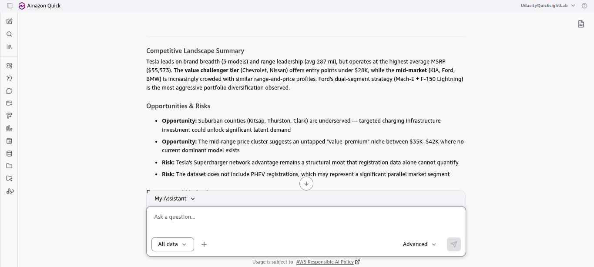

#### 5. Live Multi-Step Agent Conversation, Grounded Insights & Competitive Synthesis (`Quick Chat`)

.png)

#### 6. Workspace Organization & Dataset Governance (`Quick Spaces`)

.png)

---

## Appendix: Executive Decision Summary & Signal Governance

### 1. One-Page Decision Dashboard
| Insight Area | Key Signal / Metric | Confidence | Primary Risk | Recommended Action |
|---|---|---|---|---|
| **1. OEM Price Compression & Utility Gap** | GM grew to **13.2%** (`$35k` Equinox EV); **$3k–$10k** incentives; F-150 Lightning at **$55,974**; Ford **$19.5B** EV restructuring | **High** | Single-OEM model cancellation or production delays | Adopt multi-OEM procurement (**GM, Ford, Kia, Nissan, Tesla**) to avoid vendor lock-in |
| **2. Public Corridor Deficit & Depot Priority** | **59.1%** corridor spacing coverage; only **96** operational NEVI stations; EV-to-charger ratio trending **18:1 → 80:1** | **High** | Public DCFC queuing & utility demand-charge spikes | Bundle automated **shared depot load-management** software as the core offering |
| **3. Post-45W Urban TCO Advantage** | **~9%–24%** TCO advantage on **80–250 mi/day** return-to-base routes; **11 ACT-mandate states**; packs hitting **$92/kWh** by 2027 | **Medium** | Cold-weather range loss (20–30%) & local tariff variance | Launch a **60-day Q1–Q2 2027 pilot** on predictable urban routes in ACT states |
| **4. Dual-Standard NACS Transition** | **~20%** non-Tesla EVs shipping with native NACS; **72.7%** of grounded fleet is CCS1; transition runs through **2028** | **Medium** | Stranded single-standard depot chargers before 2028 | Mandate **dual CCS1 + SAE J3400 (NACS)** hardware & adapter tracking |

### 2. Signal Freshness & "What Would Change Our Mind?"
* **Signal Freshness:** Internal dataset (`ev_market_population_data.csv`, 2021–2025) and all 20 external Quick Research signals were captured in **October 2026** and remain valid for Q4 2026–Q2 2027 capital planning.
* **Falsification Triggers (What Would Change Our Mind?):**
  * **Trigger 1 (Utility & TCO Shift):** Utility demand-charge tariffs or winter range loss pushing urban return-to-base pilot TCO above ICE parity (`>$0.89/mi`).
  * **Trigger 2 (Policy / Infrastructure Acceleration):** Repeal of state ACT mandates in target states or NEVI corridor spacing surging past 85% ahead of 2027.

### 3. Impact vs. Effort Action Matrix
| Recommended Action | Business Impact | Implementation Effort | Confidence | Priority |
|---|---|---|---|---|
| **Launch 60-day urban return-to-base pilot in ACT states (Q1–Q2 2027)** | High | Low | **Medium-High** | **P1 — Immediate** |
| **Configure multi-OEM & dual CCS1/NACS telematics readiness** | High | Medium | **High** | **P1 — Immediate** |
| **Deploy `Market Intelligence - EV Fleet Strategy` Space to 10–15 power users** | Medium | Low | **High** | **P2 — Quick Win** |

### 4. Best-Performing Agent Prompts
1. **Internal Grounding:** *"Using `ev_market_population_data.csv`, summarize BEV registration share by brand, county concentration, and MSRP-to-range clusters. If a metric is missing, state 'Data not present in knowledge base.'"*
2. **External Signal Synthesis:** *"Compare North American commercial EV TCO post-Section 45W expiration against public NEVI corridor readiness and NACS (SAE J3400) adoption timelines, citing 2024–2027 sources."*
3. **Reliability & Guardrails:** *"Identify sample-size limitations, regional bias in Washington State registrations, and explicit conclusions leadership must NOT draw from this dataset."*
